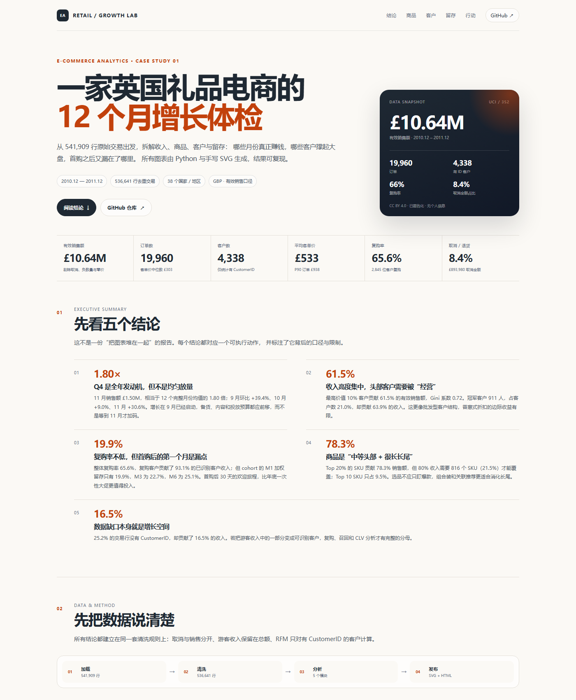
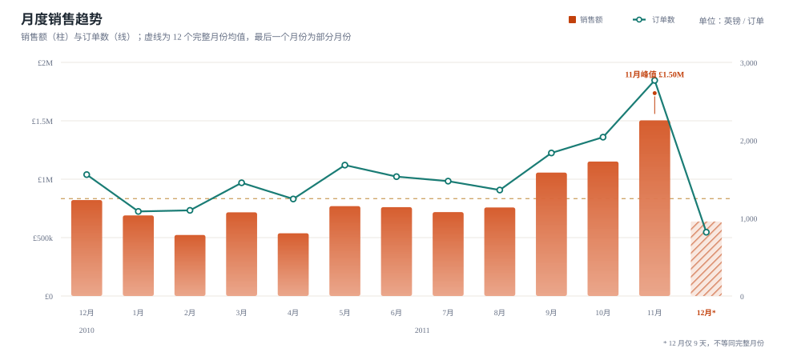
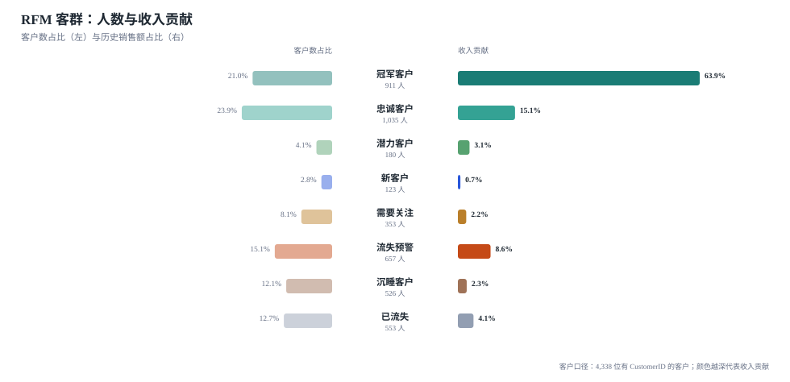

<div align="center">

# 电商增长分析 · E-commerce Growth Analytics

**把 53.7 万行交易，变成一套增长决策。**

一个可直接运行、可复现、可部署到 GitHub Pages 的电商数据分析作品集。  
覆盖数据清洗、经营指标、商品 Pareto、RFM 分层、cohort 留存、购物篮与行动建议。

[](https://www.python.org/)
[](https://pandas.pydata.org/)
[](tests/)
[](LICENSE)
[](data/README.md)

[报告](docs/index.html) · [方法](docs/methodology.md) · [数据说明](data/README.md) · [GitHub](https://github.com/dwz72978-stack)

</div>

---

## 这是什么

一份基于 **UCI Online Retail** 的端到端电商分析：

- 数据：一家英国礼品电商，2010-12 至 2011-12，**541,909 行原始交易**
- 分析：收入趋势、国家结构、商品集中度、RFM、cohort、购物篮、取消/退货
- 产出：一个自包含 HTML 报告 + 9 张 SVG 图表 + 6 张明细表 + 机器可读指标
- 工程：纯 Python / pandas，手写 SVG，无 BI 工具、无图表库、无前端框架
- 复现：数据随仓库提供，一条命令重建全部结果

> 报告文件：[`docs/index.html`](docs/index.html)  
> 启用 GitHub Pages 后，可直接在线访问（见下方部署说明）。

<p align="center">
  
</p>

## 30 秒看懂

| 指标 | 结果 | 说明 |
| --- | ---: | --- |
| 有效销售额 | **£10.64M** | 剔除取消、负数量、零价 |
| 订单数 | **19,960** | 有效销售发票 |
| 有 ID 客户 | **4,338** | 仅统计 CustomerID 非空 |
| 客单价 | **£533** | 中位数 £303，均值受批发大单影响 |
| 复购率 | **65.6%** | 2,845 位客户购买 ≥ 2 次 |
| 取消/退货金额占比 | **8.4%** | £893,980 取消金额 |
| Top 10% 客户收入占比 | **61.5%** | Gini = 0.72 |
| 11 月销售额 | **£1.50M** | 完整月均值的 1.80 倍 |
| 80% 收入所需 SKU | **816 个 / 21.5%** | 长尾很长 |
| 首购后 M1 留存 | **19.9%** | cohort 加权口径 |

## 五个结论

1. **Q4 是全年发动机，但增长从 9 月就开始了。**  
   11 月销售额 £1.50M，是 12 个完整月份均值的 1.80 倍；9 月环比 +39.4%、10 月 +9.0%、11 月 +30.6%。备货、素材和投放预算都应该前移。

2. **收入高度集中，头部客户需要被“经营”。**  
   最高价值 10% 客户贡献 61.5% 的销售额；冠军客户 911 人，占客户数 21.0%，贡献 63.9% 的收入。普惠式折扣的边际收益有限，关键客户计划更值得做。

3. **复购率不低，但首购后的第一个月是漏点。**  
   整体复购率 65.6%，复购客户贡献 93.1% 的已识别收入；但 cohort 的 M1 加权留存只有 19.9%，M3 22.7%，M6 25.1%。首购后 30 天的欢迎旅程，比年底一次性大促更值得投入。

4. **商品是“中等头部 + 很长长尾”。**  
   Top 20% SKU 贡献 78.3% 销售额，但 80% 收入需要 816 个 SKU 才能覆盖；Top 10 SKU 只占 9.5%。组合装、搭配购和关联推荐，比继续押注单个爆款更适合消化长尾。

5. **数据缺口本身就是增长空间。**  
   25.2% 的交易行没有 CustomerID，却贡献 16.5% 的收入。把游客收入中的一部分变成可识别客户，复购、召回和 CLV 分析才有完整的分母。

## 图表预览

<p align="center">
  
</p>

<p align="center">
  
</p>

更多图表：国家结构、商品 Pareto、Lorenz 曲线、cohort 热力图、下单时段热力图、关联规则、取消/退货趋势——都在 [`docs/figures/`](docs/figures/) 与完整报告中。

## 快速开始

### 环境

- Python 3.10+
- 依赖：`pandas`、`numpy`（开发依赖：`pytest`、`ruff`）

### 运行

```bash
git clone https://github.com/dwz72978-stack/ecommerce-growth-analytics.git
cd ecommerce-growth-analytics

python -m venv .venv
# Windows
.venv\Scripts\activate
# macOS / Linux
source .venv/bin/activate

pip install -e ".[dev]"
python run_analysis.py
```

Windows 打开报告：

```powershell
start docs/index.html
```

macOS：

```bash
open docs/index.html
```

输出：

```text
docs/index.html          # 自包含报告（图表内联 SVG）
docs/figures/*.svg       # 9 张独立图表
reports/metrics.json     # 机器可读指标
reports/*.csv            # 月度、国家、商品、RFM、cohort、购物篮
```

### 快速试跑

```bash
python run_analysis.py --sample
```

使用 12,000 行样例数据，几秒内完成全流程，适合先验证环境。

### 测试

```bash
python -m unittest discover -s tests -v
# 或
pytest
```

## 项目结构

```text
ecommerce-growth-analytics/
├── run_analysis.py              # 零安装入口
├── pyproject.toml
├── src/ecommerce_analytics/
│   ├── data.py                  # 加载、清洗、质量检查、聚合
│   ├── metrics.py               # KPI、集中度、Lorenz
│   ├── rfm.py                   # RFM 打分与 8 类客群
│   ├── cohort.py                # 月度 cohort 留存
│   ├── basket.py                # 购物篮关联规则
│   ├── charts.py                # 9 张手写 SVG 图表
│   ├── reporting.py             # 静态 HTML 报告
│   └── pipeline.py              # 端到端编排
├── data/
│   ├── raw/online_retail.csv.gz # 完整数据（7.6 MB）
│   └── sample/                  # 12k 行样例
├── docs/
│   ├── index.html               # GitHub Pages 入口
│   ├── methodology.md           # 方法与口径
│   └── figures/*.svg
├── reports/                     # CSV / JSON 结果
├── tests/                       # 单元测试
└── scripts/fetch_data.py        # 可选：重新下载原始数据
```

## 方法速览

| 模块 | 做法 | 关键口径 |
| --- | --- | --- |
| 数据清洗 | 解析、去重、取消单分离 | 移除 5,268 行完全重复 |
| 经营指标 | 月度/国家/订单聚合 | 有效销售 = 正数量 × 正单价，且非 C 单 |
| 商品分析 | Pareto + ABC 视角 | 核心 SKU：5 位数字 + 可选字母 |
| 客户分层 | RFM 1–5 分 + 8 类规则 | 仅 4,338 位有 CustomerID 客户 |
| 留存 | 月度 cohort 矩阵 | 排除首月左截断，仅完整月份 |
| 购物篮 | Top 60 SKU 的成对规则 | lift ≥ 1.2，置信度 ≥ 10% |

完整定义、公式和限制见 [`docs/methodology.md`](docs/methodology.md)。

## 数据与许可

- **数据**：Chen, D. (2015). *Online Retail* [Dataset]. UCI Machine Learning Repository.  
  DOI: [10.24432/C5BW33](https://doi.org/10.24432/C5BW33) · License: **CC BY 4.0**
- **代码**：**MIT**，见 [`LICENSE`](LICENSE)
- **数据副本**：`data/raw/online_retail.csv.gz` 为字段重命名的 CSV 副本，随仓库提供以便离线复现；数据版权归原作者/提供方，MIT 不替代数据许可。
- 客户 ID 为 UCI 提供的匿名标识；仓库不包含姓名、地址、邮箱、支付信息。

如果复用数据，请保留以上 attribution；如果复用代码，请保留 MIT 版权声明。

## 部署到 GitHub Pages

报告是完全静态的 `docs/index.html`，图表内联，无需服务器。

1. 把仓库推到 GitHub。
2. 打开 **Settings → Pages**。
3. **Build and deployment → Source** 选择 **Deploy from a branch**。
4. Branch 选择 `main`，Folder 选择 `/docs`，保存。
5. 稍等片刻，访问：

```text
https://dwz72978-stack.github.io/ecommerce-growth-analytics/
```

> `docs/.nojekyll` 已加入，避免 Jekyll 处理静态资源。

## 换成你自己的数据

只要 CSV/CSV.GZ 包含以下列（支持 UCI 原始列名或 snake_case），即可复用：

```text
invoice_no, stock_code, description, quantity,
invoice_date, unit_price, customer_id, country
```

```bash
python run_analysis.py --input path/to/your_transactions.csv.gz
```

注意：

- 取消单请用以 `C` 开头的发票号表示；
- `customer_id` 为空会被视为游客；
- 时间跨度建议至少 6 个月，否则 cohort 与季节性分析会不稳定。

## Roadmap

- [ ] 接入成本/毛利字段，补充利润与折扣分析
- [ ] 增加 CLV / 复购预测（BG-NBD 等）与流失打分
- [ ] 为 Top 3 组合提供 A/B 测试模板与样本量计算
- [ ] 增加 Streamlit 交互版（保留静态报告作为默认交付）
- [ ] 数据刷新自动化与 GitHub Actions 定时重建

## 作者

**dwz72978-stack** · [GitHub](https://github.com/dwz72978-stack)

如果这个项目对你有帮助，欢迎 Star、提 Issue，或直接 Fork 成你自己的作品集。

## License

- Code: [MIT](LICENSE)
- Data: [CC BY 4.0](data/README.md)
